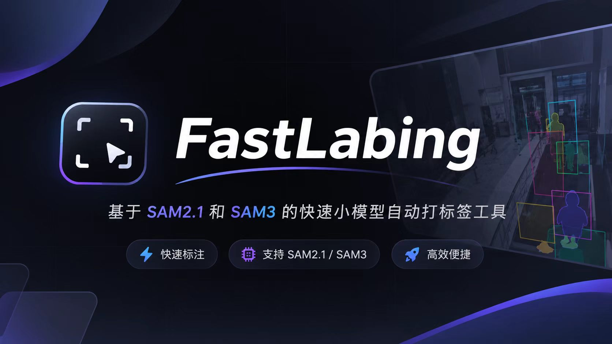

<div align="center">



# FastLabing 视频标注台

**浏览器里的视频目标框标注工具 —— 画一个框，让 SAM 帮你跟完整个视频。**

SAM 2.1 · SAM 3 · COCO 导出 · 加密打包 · 全本地运行


</div>

---

## 这是什么

FastLabing 是一个跑在本机的**视频目标框标注工具**。上传视频 → 自动分帧 → 手工画一个框 → 交给 SAM 2.1 / SAM 3 跨帧跟踪 → 导出标准 COCO 数据集。

全程浏览器操作，数据不出本机，不需要登录、不需要联网（装完依赖之后）。

适合：做检测/跟踪数据集、给短视频打框、把已有的手工标注补全。

## 核心功能

| 功能 | 说明 |
| --- | --- |
| 🎬 视频分帧 | 支持 MP4 等常见格式，按自定义 FPS 抽帧（默认 10 fps），内置 ffmpeg，不用另外装 |
| ✏️ 手工画框 | 拖拽画框、移动、缩放、改 ID、删除，支持 Ctrl+Z 撤销 |
| 🤖 AI 自动打标 | 基于 SAM 3 的图像/视频自动分割，框住一个目标就能推完全程 |
| 🔁 智能跟踪 | SAM 2.1 / SAM 3 双后端，随时切换；只补空缺帧，也可「覆盖」强制重跟 |
| 🧩 批量操作 | 按 ID 全局显隐、当前帧多选、批量删除/跟踪、批量改 ID（全部帧/当前帧/帧范围） |
| 💾 断点续跑 | 任务中断后自动从最后一个完成帧继续，不会把半成品写进标注 |
| 📦 导出 | COCO 格式导出，可生成加密 ZIP |
| 📊 运行监控 | 实时 GPU 占用、缩略图条、项目管理、项目目录一键打开 |

## 快速开始

> Windows 10 / 11 x64，NVIDIA 显卡（sm_7.5 以上：GTX 16 系 / RTX 20–50 系）

```text
1. 解压到任意目录（建议磁盘剩余 ≥ 18GB）
2. 双击「一键安装依赖.bat」     ← 装 Node 依赖 + Python 环境 + PyTorch + 模型权重
3. 双击「一键启动.bat」         ← 浏览器自动打开 http://127.0.0.1:3000
```

卸载/清理：双击「一键删除.bat」（默认保留模型权重和项目数据）。

安装脚本的细节、离线安装、换镜像、指定已有 Python 环境等，见 **[部署.md](部署.md)**。

## 目录结构

```text
FastLabing/
├─ 一键安装依赖.bat          安装依赖（调用 scripts/install.ps1）
├─ 一键启动.bat              启动服务（调用 scripts/start.ps1）
├─ 一键删除.bat              清理依赖（调用 scripts/uninstall.ps1）
├─ scripts/                  install / start / uninstall 三个 PowerShell 脚本
├─ server/                   Express 服务、抽帧、导出、SAM worker（Python）
├─ public/                   前端页面与静态资源
├─ bin/ffmpeg.exe            内置 ffmpeg（无需系统安装）
├─ models/                   模型权重（不入库，安装时自动下载）
├─ python/requirements.txt   Python 依赖清单
├─ third_party/sam3/         SAM 3 源码（含 tokenizer 资源）
└─ docs/                     文档与图片
```

**代码与数据分离**：项目数据默认放在程序**同级**目录 `..\Fastlabing-data\`，删程序不会删数据。

```text
D:\FastLabing\          程序 + 依赖
D:\Fastlabing-data\     视频、帧图、标注、导出（运行时自动创建）
```

## 模型权重

| 模型 | 文件 | 大小 | 获取方式 |
| --- | --- | --- | --- |
| SAM 2.1 tiny | `models\sam2.1_hiera_tiny.pt` | 156 MB | 安装脚本自动从 ModelScope 镜像下载（断点续传） |
| SAM 3 | `models\sam3.pt` | 3.45 GB | 安装脚本自动从 ModelScope 镜像下载 |

- 两个文件**都不入库**（`.gitignore` 已排除）。
- `models\` 里已有且大小正确时，安装脚本直接跳过，不会重复下载。
- 手动下载地址：<https://modelscope.cn/models/facebook/sam3>（国内直连）。
- 没有 SAM 3 权重时，SAM 2.1 仍然可用，只是「AI 自动打标」受限。

## 环境要求

| 项目 | 要求 |
| --- | --- |
| 系统 | Windows 10 / 11 x64 |
| 显卡 | NVIDIA，算力 ≥ sm_7.5（GTX 16 系 / RTX 20/30/40/50 系）；8GB 显存起步，12GB+ 更流畅 |
| Node.js | 18 或更高（[下载](https://nodejs.org/zh-cn/download)） |
| Python | 3.10 / 3.11 / 3.12（没有的话安装脚本会自动装 3.10.11） |
| 磁盘 | ≥ 18 GB（PyTorch 2.5GB + 权重 3.6GB + 依赖 + 运行数据） |

> 没有 NVIDIA 显卡也能运行：Web 标注功能完整可用，只是 AI 相关按钮不可用。

## 常见问题

<details>
<summary><b>提示未找到 Node.js</b></summary>

装 Node.js 18+（<https://nodejs.org/zh-cn/download>），装完重开一个窗口再双击「一键安装依赖.bat」。
</details>

<details>
<summary><b>装 PyTorch 很慢 / 失败</b></summary>

安装脚本已经内置三级镜像（上海交大 → 阿里云 → 官方源），一般不会卡。若公司网络限制严格，可挂代理后重试，见 [部署.md](部署.md#换镜像与代理)。
</details>

<details>
<summary><b>我已经有装好依赖的 Python 环境</b></summary>

把那个解释器的完整路径写进程序目录的 `python-path.txt`（一行），安装和启动都会直接复用它，不再创建 `.venv`。这个文件只适合本机，别一起打包发出去。
</details>

<details>
<summary><b>端口 3000 被占用</b></summary>

启动脚本会自动顺延到 3001、3002……；也可以设置环境变量 `PORT=3100` 再启动。
</details>

<details>
<summary><b>SAM 3 很慢 / 显存不足</b></summary>

改用 SAM 2.1，或在 SAM 3 下选「快速 / 极速」精度档（隔帧跟踪 + 线性插值）。8GB 显存长时间跟踪建议直接用 SAM 2.1。
</details>

<details>
<summary><b>AI 按钮是灰的 / 点不了</b></summary>

按顺序排查：① 显卡是否是 N 卡且驱动正常（`nvidia-smi` 能跑）；② 是否装了 AI 环境（`scripts\install.ps1` 跑完自检是否 PASS）；③ `models\` 里权重是否齐全。
</details>

## 环境变量（进阶）

| 变量 | 作用 | 默认 |
| --- | --- | --- |
| `FASTLABING_STORAGE` | 数据目录 | `..\Fastlabing-data` |
| `PORT` | 服务端口 | `3000`（占用自动顺延） |
| `PYTHON` | 指定解释器 | `.venv\Scripts\python.exe` |
| `SAM3_REPO` / `SAM3_CKPT` | SAM 3 源码 / 权重路径 | `third_party\sam3` / `models\sam3.pt` |
| `SAM2_CKPT` | SAM 2.1 权重路径 | `models\sam2.1_hiera_tiny.pt` |
| `AUTO_OPEN` | 启动后是否自动开浏览器 | `1` |

## 第三方组件与许可

| 组件 | 来源 | 许可 |
| --- | --- | --- |
| SAM 3 | [facebookresearch/sam3](https://github.com/facebookresearch/sam3) | SAM License（权重为 gated，需自行遵守其条款） |
| SAM 2 / 2.1 | [facebookresearch/sam2](https://github.com/facebookresearch/sam2) | Apache 2.0 |
| FFmpeg | [ffmpeg.org](https://ffmpeg.org/) | LGPL / GPL（随包提供二进制） |
| 7-Zip | [7-zip.org](https://www.7-zip.org/) | GNU LGPL（经 `7zip-bin` 调用） |

本项目自有代码见 [LICENSE](LICENSE)。商用前请自行确认上述第三方许可条款，尤其是 SAM 3 权重的使用范围。
